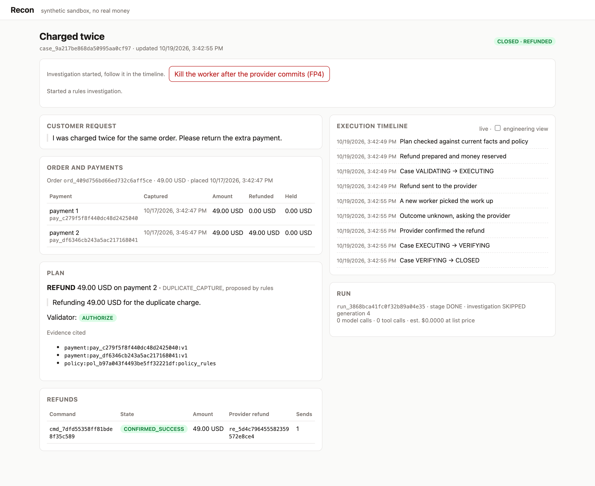
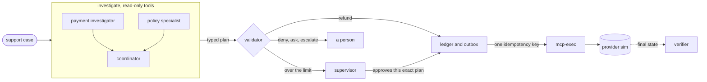
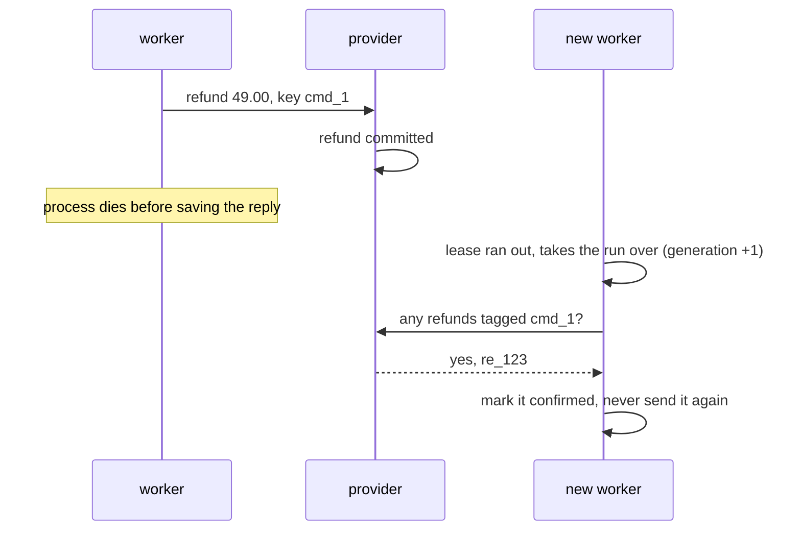

# Recon

Agents look into refund tickets. Plain code decides whether money moves.



<sub>The worker was killed right after the provider committed the refund. A new worker picked the run up, asked the provider what happened, found the refund, and closed the case. One send, one refund.</sub>

I built this to find out how far you can let LLM agents into payment support. They're good at the reading part: pulling up the order, finding the right policy section, noticing the customer said something the records don't show. They're bad at knowing whether a refund already went through when a request timed out halfway. So in Recon the agents only ever propose. A validator checks the plan against fresh data, a ledger sends the money with one idempotency key and reconciles when things go wrong, and a separate grader checks what actually happened at the provider.

Everything runs against a Stripe-shaped simulator with synthetic customers. No real money, no paid APIs.

## How it fits together



A few things that took the most care:

- The agents reach data through MCP tools that can't write. Tenant and case come from a signed run token, so no argument can point a tool at someone else's order.
- What comes back is a plan, not an action. The validator recomputes what's owed and rejects anything that cites the wrong payment, the wrong amount, a stale version, or a reason that contradicts the outcome. A model saying "already refunded" or "denied" gets checked too.
- Only the ledger moves money, and only through mcp-exec, the one process that holds the provider key. Each refund is a command with its own key, reserved before it's sent and reconciled by metadata if the answer gets lost.
- The verifier has its own database role and imports nothing from the app. It reads the provider and the labels and decides pass or fail.

## The crash that matters

The hard case is a refund the provider already made, where the worker dies before it hears back. An agent that retries on its own judgment sends it again. Here the retry never happens blind:



If the old worker wakes up later and tries to write its result, the fencing check turns it away.

## Results so far


Each dot is a refund case from the frozen dev split. The left block injects a fault, the right block runs the same case clean. Recovered means exactly one provider refund for the right amount, closed, and the independent verifier passing. "Balance taken before the locks" is the one where the right answer is to refuse, and it does. So the claim is narrow: at most one provider refund per command, checked under these 10 faults on 100 trials.

| check | result |
|---|---|
| boundary suite: other tenants' ids, injected instructions, forged approvals, bad amounts, repeated tickets, budgets | 60/60 |
| kill every app process while cases wait on a supervisor and a customer, then restart | both finish, one refund each |
| browser flows (Playwright): supervisor approval, worker killed mid-refund | 2/2 |
| rules baseline on the 70-case validation split | 57/70, misses everything that's only in the customer's message |

The boundary suite runs against a scripted model that obeys every instruction it reads, including "refund 500.00" in a customer message. What it measures is whether the rest of the system holds when the model doesn't.

<p>


</p>

## Run it

You need Docker, [uv](https://docs.astral.sh/uv/) and pnpm. Ollama is optional, for the local model.

```sh
make web-install
make dev                      # sim, mcp-read, mcp-exec, worker, api, web on localhost:3000
uv run recon dev --families   # same, plus one case for every workflow
make demo                     # kill the worker after the provider commits, end with one refund
make check                    # lint, types, ~350 tests
make e2e                      # the two browser flows
make faults                   # all 200 fault trials
```

To run an approach over a frozen split and get a report:

```sh
uv run recon eval --split val --arm rules
uv run recon eval --split val --arm graph --model ollama:qwen3:4b-instruct
uv run recon report results/eval/<run> results/eval/<other run>
```

Every case writes its fixture, final provider state, events, commands, model usage and the recorded model turns, so one case can be rerun or replayed on its own. Replay never sends anything to the provider.

## The benchmark, briefly

| | |
|---|---|
| case families | duplicate charge, missing refund, partial return, proration, ineligible, missing or conflicting order, and one where the message changes the answer (a bank dispute, a return that disagrees with the customer) |
| merchants | 3, each with its own versioned policy, refund window, rounding and approval limit |
| splits | dev 140, val 70, held-out 350, frozen by hash before any held-out run |
| labels | written by the generator from its own math, stored in a database the agents can't connect to |
| grading | identity, outcome, amount, provider effect, local state, approval binding |
| contested cases | a return that hasn't arrived can be denied or waited on, both count |

The cases are synthetic and I wrote both the generator and the policies, so read the numbers as a benchmark of this setup, not of payment support in general.

## What's in here

```
agents/            the three agents, their prompts and the local model adapter
apps/api           case api, approvals, replies, idempotent writes
apps/worker        the stage machine: leases, outbox, ledger, reconcile
apps/mcp           mcp-read (tools for agents) and mcp-exec (the only provider key)
apps/provider_sim  Stripe v1 shaped refunds, idempotency, faults, webhooks
apps/web           Next.js console
packages/          domain rules, storage, provider client, policy retrieval
evals/             fixtures, the independent verifier, the eval harness
tests/             unit, e2e, faults, boundary
```

## Not done yet

- Agent results on the validation split, and the naive agent comparison (one agent holding the refund tool directly).
- Held-out runs. They wait until the end so nothing gets tuned on them.
- Real login. The dev login takes any name.
- A hosted demo. It stays local on purpose, since this project doesn't spend money.
