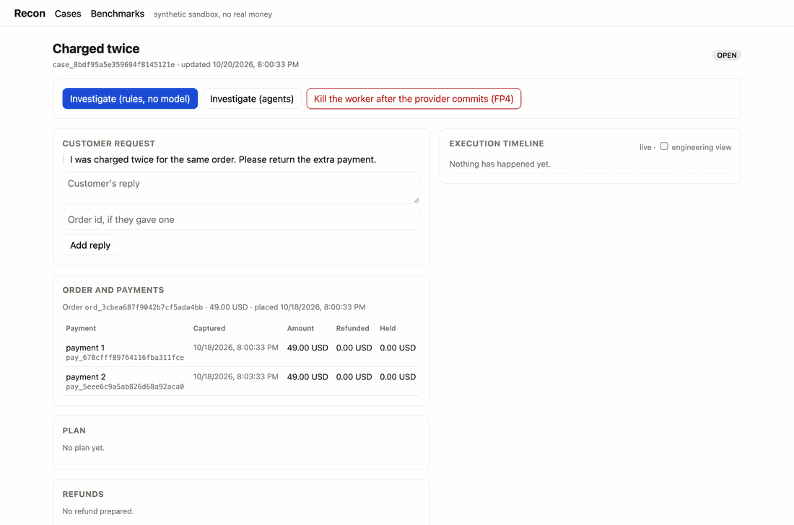
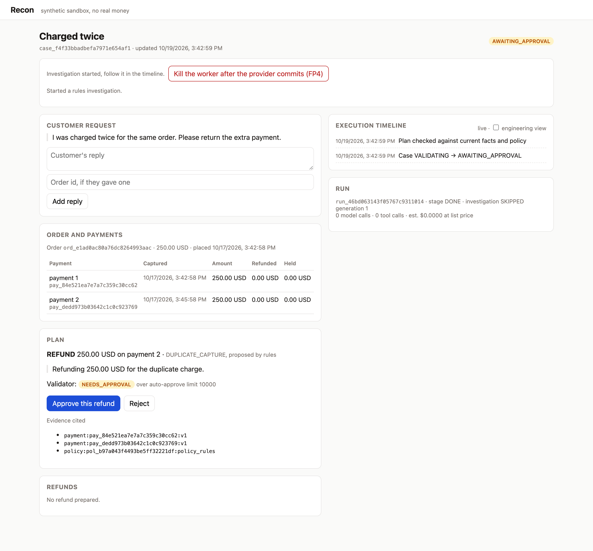
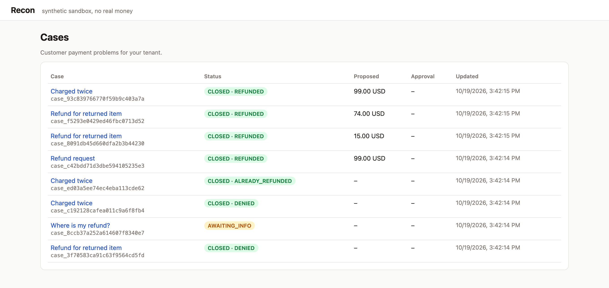
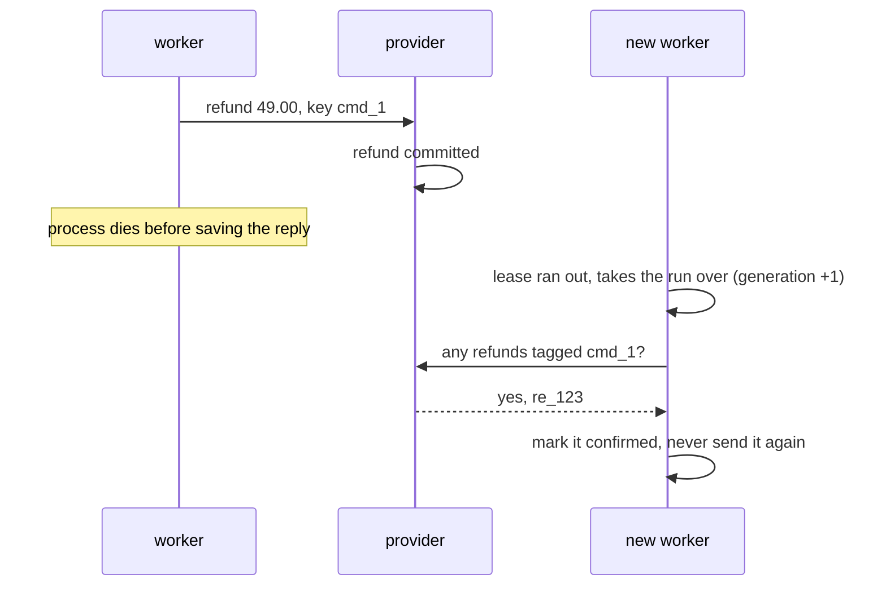
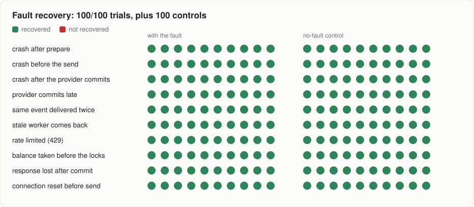
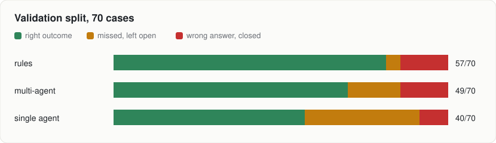
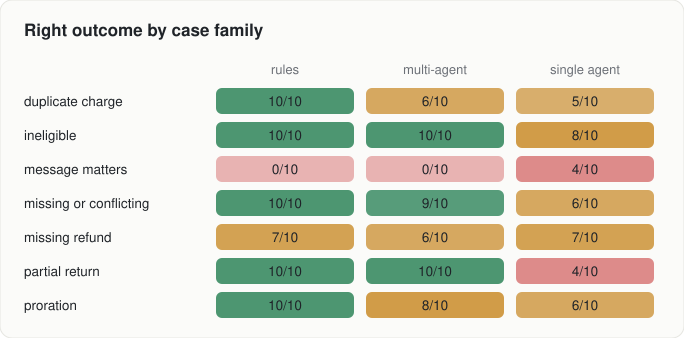
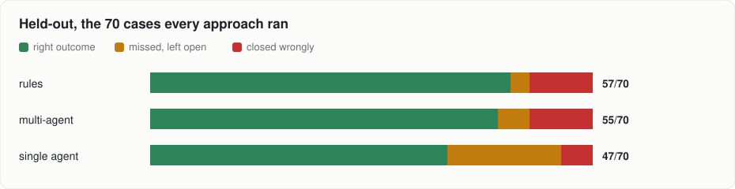
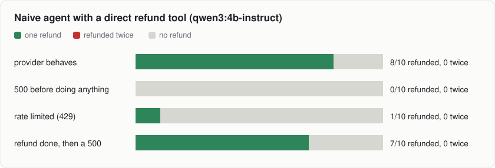
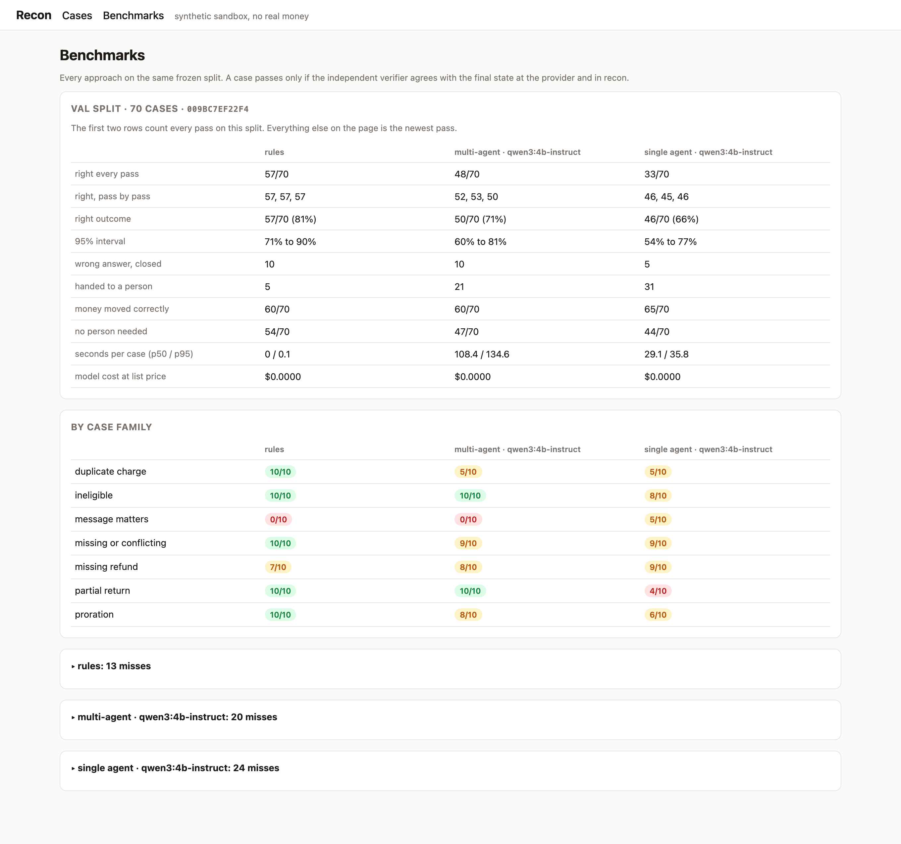

# Recon

Recon is a payment-support console where LLM agents investigate refund cases and deterministic code decides whether any money moves.



<sub>The worker dies right after the provider commits the refund. A new worker takes over, asks the provider what happened, finds the refund and closes the case. One send, one refund.</sub>

Agents are good at the reading side of payment support: pulling up the order, finding the right policy section, catching what a customer said that the records don't show. They're bad at knowing whether a refund went through when a request died halfway.

So here the agents only propose. A validator checks the plan against fresh data, a ledger sends the money under one idempotency key, and a separate verifier checks what actually happened at the provider. It all runs against a Stripe-shaped simulator with synthetic customers, so no real money and no paid APIs.

## How it fits together


- Agents read through MCP tools that can't write. Tenant and case come from a signed run token, so no argument can aim a tool at someone else's order.
- They hand back a plan, not an action. The validator recomputes what's owed and rejects the wrong payment, the wrong amount, a stale version, or a reason that contradicts the outcome. "Already refunded" and "denied" get checked too.
- Only the ledger moves money, through mcp-exec, the one process holding the provider key. Every refund is a command with its own key, reserved before it's sent and reconciled by metadata if the reply gets lost.
- The verifier has its own database role and imports nothing from the app.

<p>


</p>

<sub>Left: a refund over the merchant's limit waits for a supervisor, who approves that exact plan and nothing else. Right: the inbox, one case per workflow.</sub>

## The crash that matters

The nasty case is a refund the provider already made, with the worker dead before it hears back. An agent retrying on its own judgment pays the customer twice. Recon never retries blind:



If the old worker wakes up later, the fencing check turns it away. `make demo` runs this with a real process and `os._exit(137)`:

```text
[  worker] worker process pid 43364, faults armed: FP4 (die after the provider commits)
[    plan] run run_9ce39568fb1e0ebc1db43ec1: plan validated, refund 4900 usd on pay_f1361474e9dc17c63429e87f
[ prepare] command cmd_8e56b6270fdbf9990ac7343a prepared, 4900 reserved, idempotency key recon_cmd_8e56b6270fdbf9990ac7343a
[   crash] worker exited 137 after the provider committed ['re_25a446a4fd8a3e7e1901d9d6']
[   crash] recon still thinks the command is SUBMITTING: it never heard back
[ recover] waiting out the dead worker's lease...
[ recover] new worker took the lease, asked the provider by metadata: CONFIRMED_SUCCESS, refund re_25a446a4fd8a3e7e1901d9d6
[   close] case CLOSED REFUNDED
[  verify] provider refunds on the duplicate payment: 1, refund POSTs sent: 1
[  verify] independent verifier: PASS
```

One POST reached the provider. Recovery found it by the command id in the refund metadata and never sent another.

## Results

### When things break



Each dot is a dev case, faulted on the left and clean on the right. Recovered means one provider refund for the right amount, the case closed and the verifier passing. "Balance taken before the locks" is supposed to be refused, and it is. The claim is narrow on purpose: at most one refund per command, under these 10 faults.

| check | result |
|---|---|
| boundary suite: other tenants' ids, injected instructions, forged approvals, bad amounts, repeated tickets, budgets | 60/60 |
| kill every app process while cases wait on a supervisor and a customer, then restart | both finish, one refund each |
| browser flows (Playwright): supervisor approval, worker killed mid-refund | 2/2 |
| 25 investigations at once over 5 merchants, 3 workers killed after the provider commits (scripted model, 1 s a call) | 25/25 refunded once, none on the wrong merchant |
| the real agent path on the local model, 5 cases under each of four faults: crash after prepare, before the send, after the provider commits, every event delivered twice | 19/20 right, one handed to a person, no refund sent twice or wrongly |

The boundary suite uses a scripted model that obeys everything it reads, "refund 500.00" in a customer message included. It tests whether the rest holds when the model doesn't.

### Agents against plain rules

70 validation cases, three passes each. Rules is the policy math with no model. Multi-agent is the graph above. Single agent is one model holding every read tool. Both agent setups run qwen3:4b-instruct locally through Ollama, since it's free.



| | rules | multi-agent | single agent |
|---|---|---|---|
| right, pass by pass | 57, 57, 57 | 52, 53, 50 | 46, 45, 46 |
| right every pass | 57 | 48 | 33 |
| right at least once | 57 | 54 | 58 |
| cases that flip | 0 | 6 | 25 |
| median time a case | instant | 108 s | 29 s |

Rules win, which is less surprising than it looks. The labels come from the same policy math, so in most families a model has little to add and plenty to get wrong. Amber is a case left for a person. Red is a customer who got the wrong answer at least once.

Three passes are what separate the two agent setups:

- One pass at a time they're about 6 cases apart. Counting only cases right every time, it's 15.
- The single agent got 58 different cases right at least once, one more than rules. It just can't repeat them reliably.
- Two thirds of its misses are plans the validator sent back, most often for not citing the policy it had just searched. The multi-agent setup gives that job to its own agent, so it's slower but steadier.



Every wrong close is in one family. In "message matters" the records say refund but the customer's message changes that: a bank dispute already filed, or two items sent back where the warehouse logged one. Rules can't read, so they refund all ten.

That family is where agents should win. The multi-agent investigator does flag the dispute and the mismatch, then the 4B coordinator refunds anyway, every pass. The single agent catches 4 every time. Moving the conflict check to the top of the coordinator prompt caught 1 and broke two duplicate charges, so it was dropped. Looks like model size more than prompting.

> Pending refunds changed partway through. They now go to a person instead of counting as done, since a pending refund can still fail and nothing in Recon watches a refund it didn't send. The validator and labels changed together, the splits were frozen again, and every number here comes from the new ones.

### On cases nothing was tuned on

The 350 held-out cases stayed untouched until the end, apart from a 5-case plumbing check. Each approach ran once. At about two minutes a case, the multi-agent setup ran the first ten of each family, 70 in all.



| | rules | multi-agent | single agent |
|---|---|---|---|
| right on the 70 | 57 (71 to 90%) | 55 (69 to 87%) | 47 (56 to 77%) |
| right on all 350 | 283 (77 to 85%) | not run | 207 (54 to 64%) |
| closed wrongly on all 350 | 50 | not run | 33 |
| one validation pass, for comparison | 57 | 50 to 53 | 45 to 46 |

- Validation held up. Same order, and every approach lands within 2 cases of a validation pass.
- Rules and multi-agent are a tie. The brackets are 95% ranges, about ten points each way at 70 cases.
- The single agent slips to 59% over all 350, clearly behind rules.
- Wrong closes are still only message-matters cases. Rules get all 50 wrong, the single agent catches 17 (half on validation), the multi-agent setup none of its ten.
- Rules also drop 17 pending refunds by asking the customer instead of handing off to a person, the same miss as on validation.

### When the model holds the refund tool

The opposite design: one agent with a tool to read the case, one to quote the refund, and `create_refund`, which sends a fresh request every call like a thin API wrapper. Then the provider misbehaves on the first refund.



No red, because this model barely retries: once in 20 errored runs. Customers whose refund failed for a harmless reason never got paid, and the ones whose refund had quietly gone through got lucky.

From inside the agent both errors read "payment provider returned 500". Whether someone gets paid zero, one or two times comes down to how eager the model is, and in the last row any retry is a second refund. Recon's ledger asks the provider for a refund under that command's key before sending again, which is how it gets 100 out of 100.

## Run it

You need Docker, [uv](https://docs.astral.sh/uv/) and pnpm. Ollama is optional, for the local model.

```sh
make web-install
make dev                      # sim, mcp-read, mcp-exec, worker, api, web on localhost:3000
uv run recon dev --families   # same, plus one case for every workflow
make demo                     # kill the worker after the provider commits, end with one refund
make check                    # lint, types, ~375 tests
make e2e                      # the two browser flows
make faults                   # all 200 fault trials
make load                     # 25 investigations at once
```

Sign in as `operator` or `supervisor`, both seeded into every tenant. Only a supervisor can approve a refund. The password is `RECON_DEMO_PASSWORD`, or a local default when that's blank (see `.env.example`).

Running an approach over a frozen split:

```sh
uv run recon eval --split val --arm rules
uv run recon eval --split val --arm graph --model ollama:qwen3:4b-instruct
uv run recon eval --split val --arm single --model ollama:qwen3:4b-instruct
RECON_HELD_OUT=1 uv run recon eval --split held_out --arm rules   # refused without the flag
uv run recon report results/eval/<run> results/eval/<other run>   # same approach twice or more adds what flips
uv run recon b3 --model ollama:qwen3:4b-instruct   # the agent that holds the refund tool
```

Each case saves its fixture, provider state, events, commands, model usage and recorded model turns, so any case can be rerun or replayed alone. Replay never touches the provider. The Benchmarks tab reads the same folders and lists every miss with its reason.



## The benchmark, briefly

| | |
|---|---|
| case families | duplicate charge, missing refund, partial return, proration, ineligible, missing or conflicting order, and one where the message changes the answer (a bank dispute, a return that disagrees with the customer) |
| merchants | 3, each with its own versioned policy, refund window, rounding and approval limit |
| splits | dev 140, val 70, held-out 350, frozen by hash before any held-out run |
| labels | written by the generator from its own math, stored in a database the agents can't connect to |
| grading | identity, outcome, amount, provider effect, local state, approval binding |
| contested cases | a return that hasn't arrived can be denied or waited on, both count |

Cases, policies and labels are all synthetic and come from the same project as the agents. Read the numbers as a benchmark of this setup, not of payment support in general.

## What's in here

```
agents/            the three agents, their prompts and the local model adapter
apps/api           case api, approvals, replies, idempotent writes
apps/worker        the stage machine: leases, outbox, ledger, reconcile
apps/mcp           mcp-read (tools for agents) and mcp-exec (the only provider key)
apps/provider_sim  Stripe v1 shaped refunds, idempotency, faults, webhooks
apps/web           Next.js console
packages/          domain rules, storage, provider client, policy retrieval
evals/             fixtures, the independent verifier, the eval harness
tests/             unit, e2e, faults, boundary
```
